# Painel Enade — ICEA/UFOP

[](https://github.com/LucasECota/Painel_Enade_UFOP_Front/actions/workflows/ci.yml)


Painel web do **Instituto de Ciências Exatas e Aplicadas (ICEA) da UFOP**, em João Monlevade, que
reúne em um só lugar os dados do **Enade**: os cursos de preparação do projeto **AvaliaUFOP**, o que
cada edição cobrou, o desempenho dos alunos e os resultados oficiais do INEP, com comparação com a
média do Brasil e relatórios para baixar.

Projeto desenvolvido no âmbito do programa **Pró-Ativa (UFOP)**, por **Lucas Emanuel Cota Carneiro**,
com orientação do prof. **Josemar Alves Caetano**.

> **Repositório da API:** [Painel_Enade_UFOP_Back](https://github.com/LucasECota/Painel_Enade_UFOP_Back)
> (Node.js + Express). O guia para publicar os dois com Docker está em
> [DEPLOY.md](https://github.com/LucasECota/Painel_Enade_UFOP_Back/blob/main/DEPLOY.md).

## O problema

Os estudantes de Engenharia de Computação, Engenharia de Produção e Sistemas de Informação fazem o
Enade, mas as informações sobre a prova ficam espalhadas: relatórios em PDF do INEP, páginas de
indicadores e cursos no Moodle. O painel junta tudo em uma navegação simples, para que o aluno
entenda **o que costuma cair na prova**, **como o curso se saiu** e **onde se preparar**.

## O que o painel mostra

### Início
Apresentação do painel e atalhos para as duas áreas: **Preparatório Enade 2026** e **Dados Edições Anteriores**.

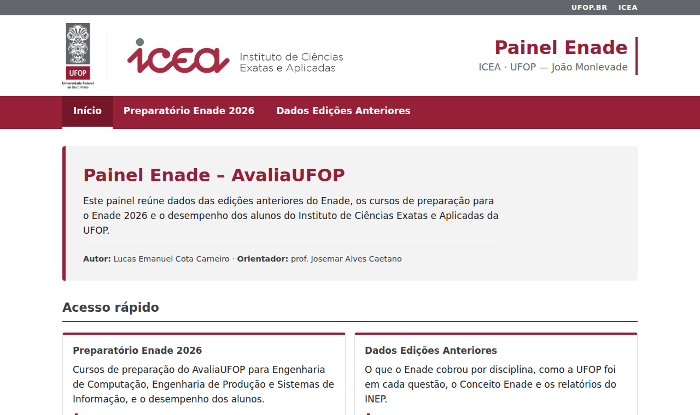

### Preparatório Enade 2026 — aba Cursos no Moodle
Os três cursos de preparação para o Enade 2026 (um por curso), com a estrutura de módulos e
atividades e o botão que leva direto à inscrição no Moodle da UFOP.

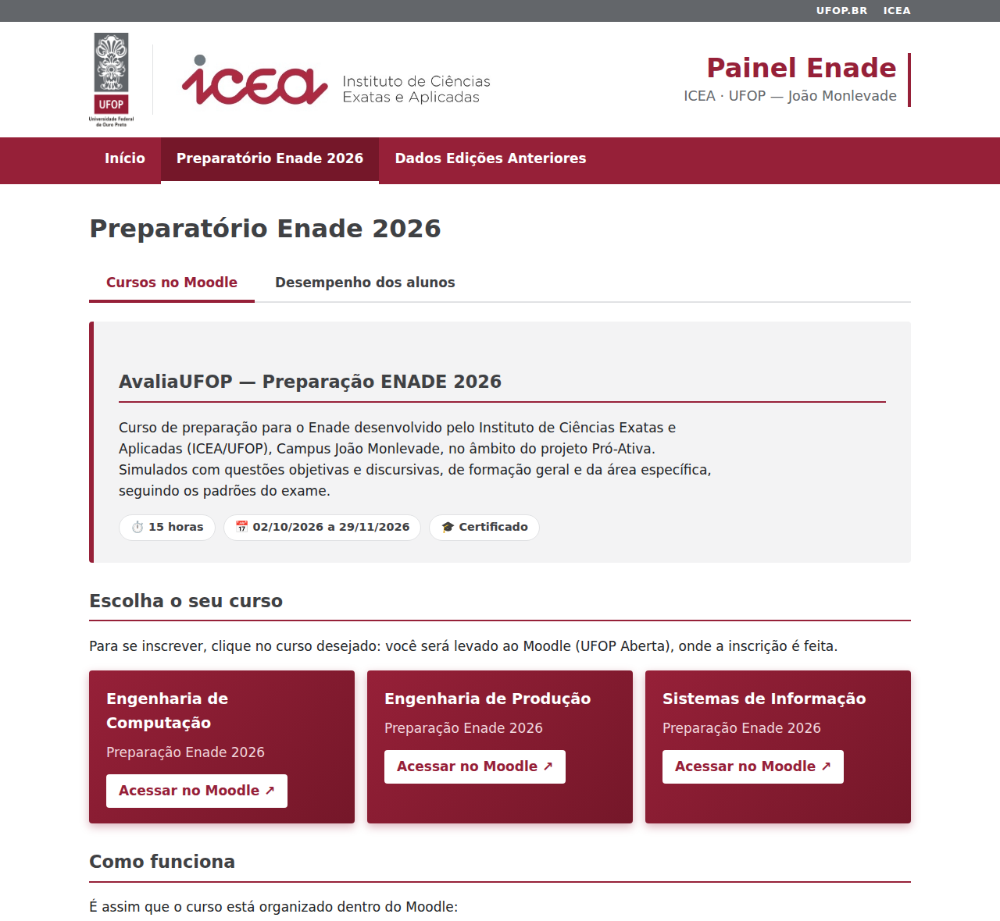

### Preparatório Enade 2026 — aba Desempenho dos alunos
Inscritos, concluintes e aproveitamento médio dos alunos em cada atividade do AvaliaUFOP, com uma
linha tracejada marcando os 60% exigidos para o certificado. Os dados vêm de exports do Moodle,
**anonimizados** antes de chegarem ao repositório.

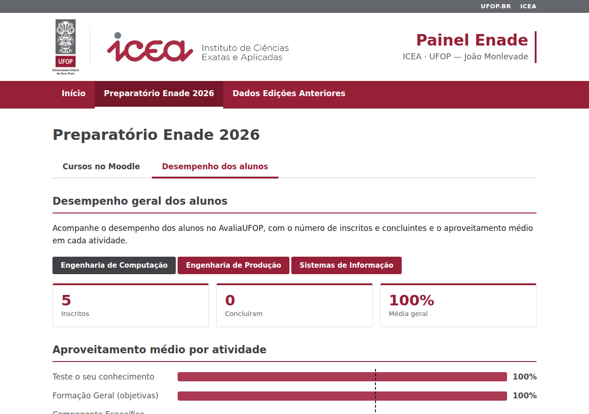

### Dados Edições Anteriores — aba Análise das provas
O que o Enade cobrou em cada edição (2014 em diante), em quatro subtópicos:

- **Assuntos por disciplina:** quantas questões (objetivas e discursivas) cada disciplina teve e quais
  foram os assuntos, para Formação Geral e Componente Específico. Cada assunto tem o botão
  **Ver questão**, que abre a imagem da questão como na prova, com o gabarito (nas discursivas, só o
  enunciado; nas anuladas, sem gabarito; nas desconsideradas, o gabarito com o aviso).

  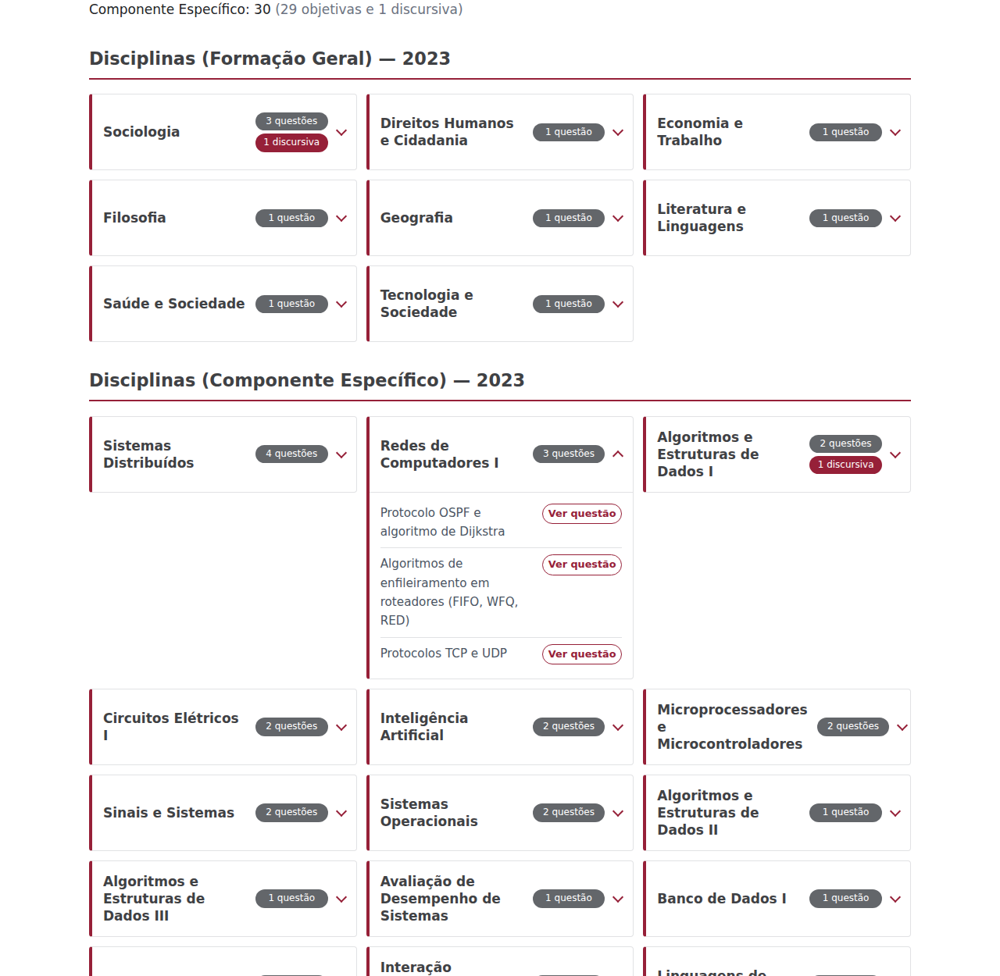

  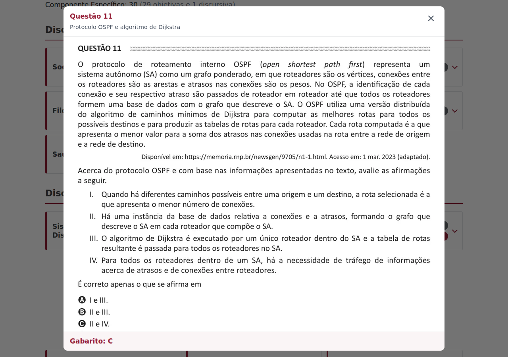

- **Acertos por questão:** tabela do Relatório de Curso do INEP com o percentual de acerto da UFOP e
  de outros grupos (Brasil, estado, região...), a disciplina, o tema e o gabarito de cada questão, e
  uma tabela só com as **questões discursivas** e a nota média. Cada tabela tem a sua ordenação e o seu
  grupo de comparação, e abre e fecha. Os relatórios do INEP ficam para baixar numa caixa no fim.

  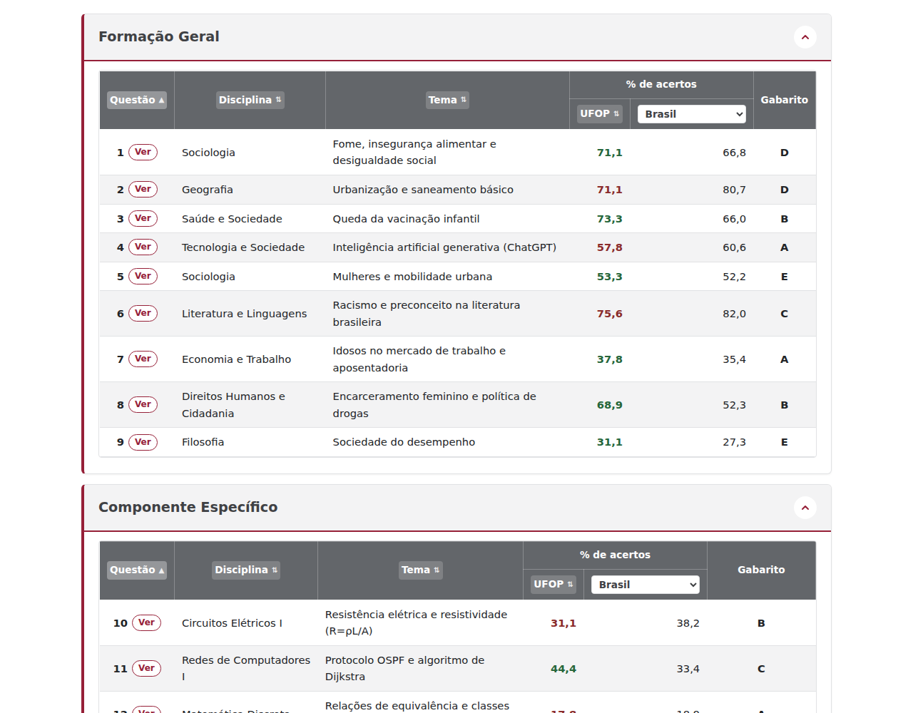

  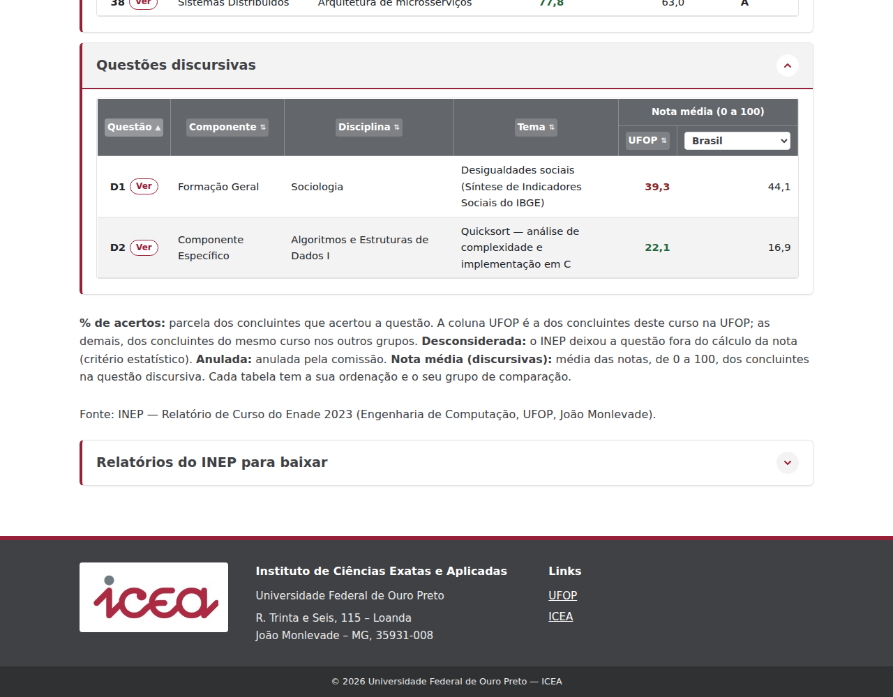

- **Evolução por disciplina:** gráfico de barras com o acerto da UFOP e do Brasil em cada edição para
  a disciplina escolhida (menu em subgrupos de disciplinas parecidas).

  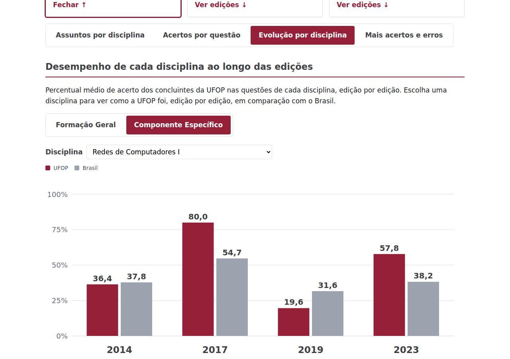

- **Mais acertos e erros:** disciplinas ou temas com mais acertos e mais erros em cada edição, com a
  escolha de quantos mostrar (3, 5 ou 10) e o botão para ver as questões de cada linha.

  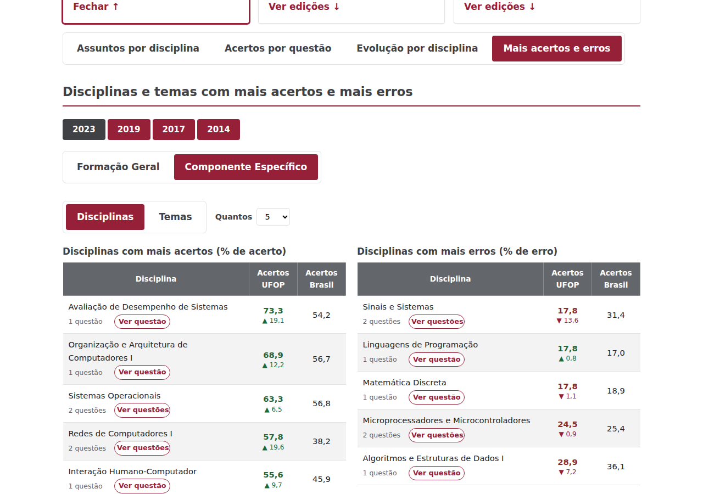

### Dados Edições Anteriores — aba Resultados dos cursos
Conceito Enade de cada edição (com o aviso do INEP de que as notas não são comparáveis entre
edições), comparação das médias do ICEA com as do Brasil (Formação Geral e Componente Específico),
perfil socioeconômico dos concluintes e os **relatórios da IES** para baixar. Os blocos de dados já
abrem abertos e podem ser escondidos.

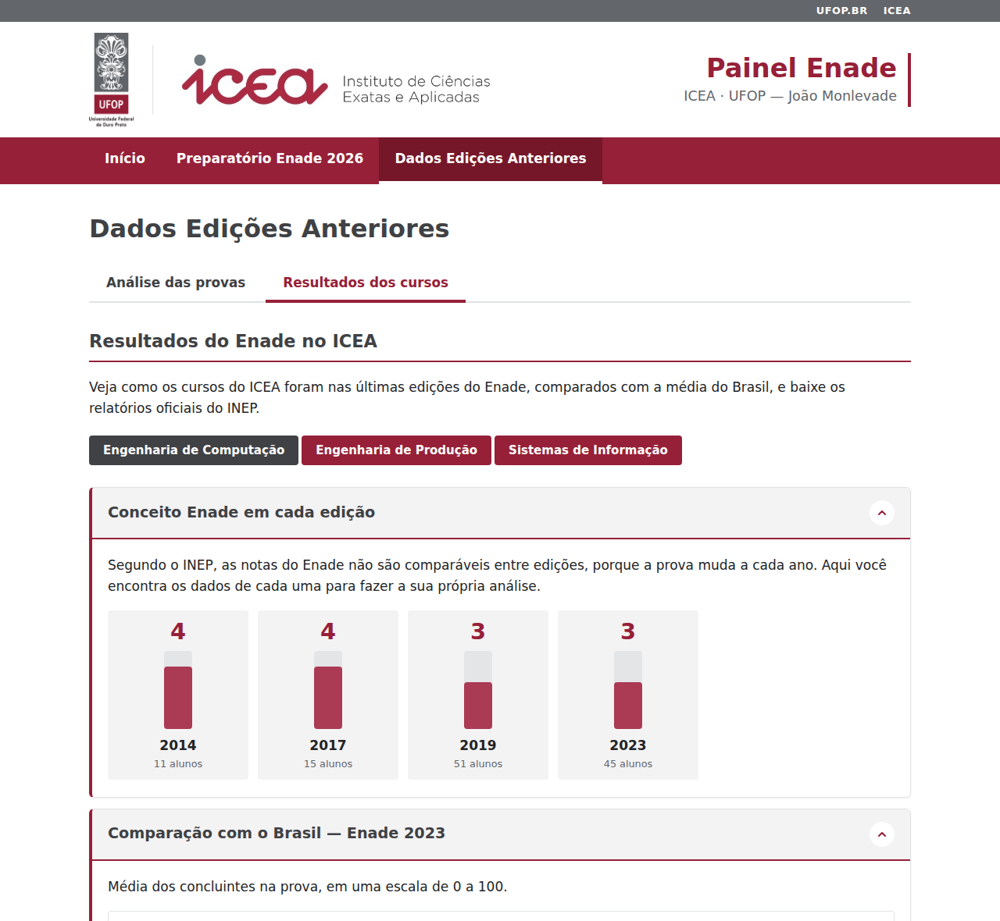

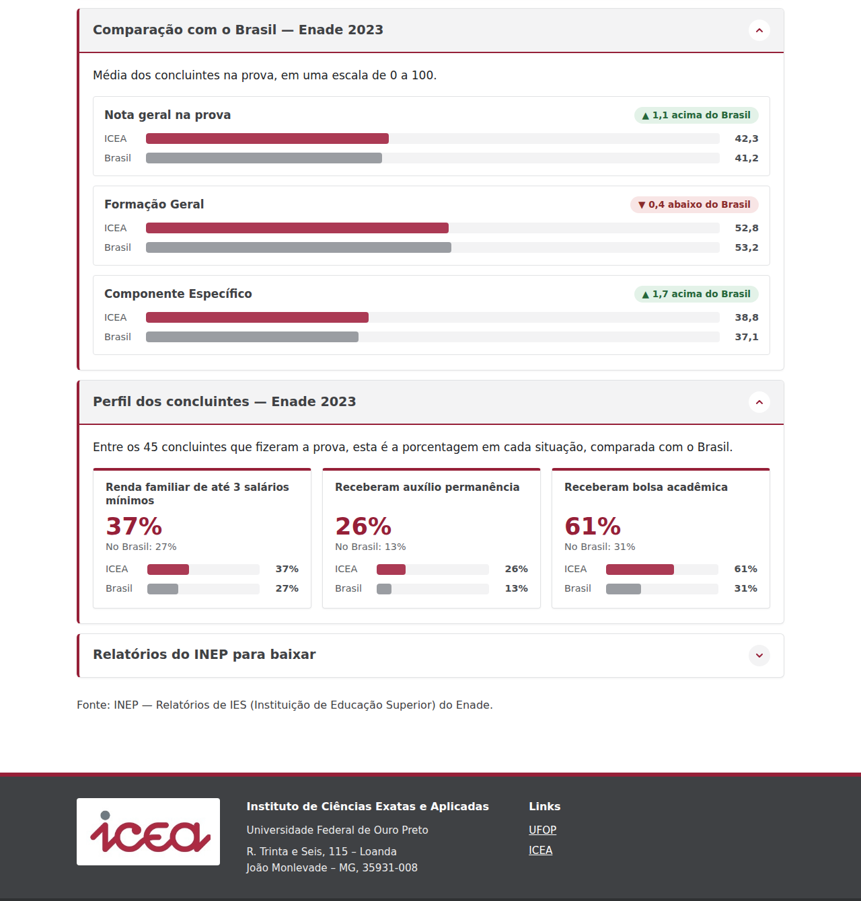

### No celular
Todas as telas foram pensadas para telas pequenas, com menu recolhido e gráficos adaptados.

<table>
  <tr>
    <td>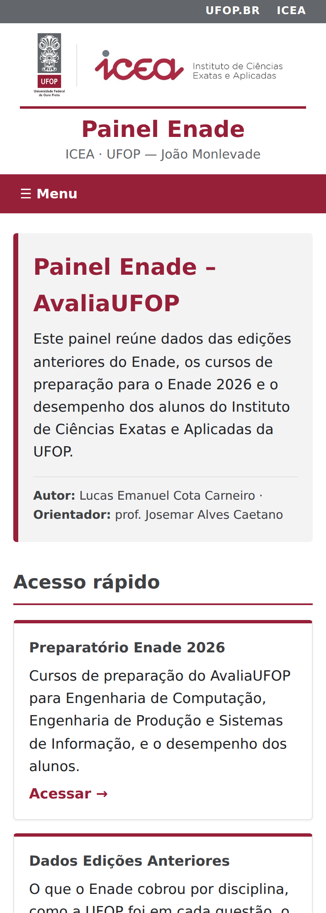</td>
    <td>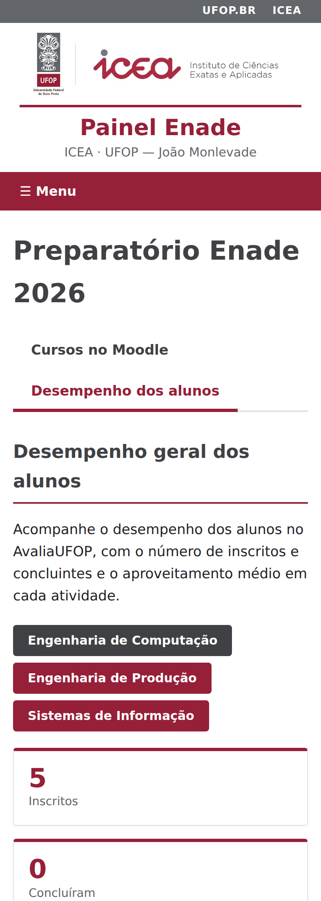</td>
    <td>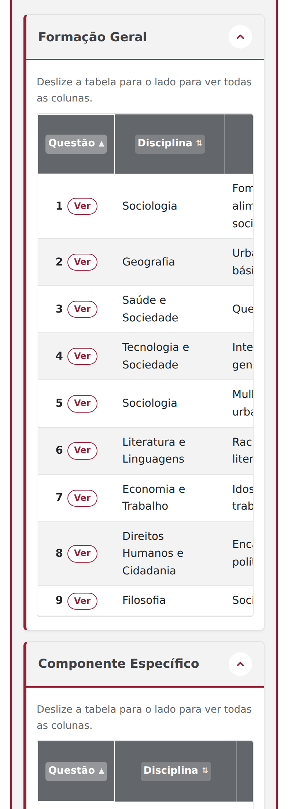</td>
    <td>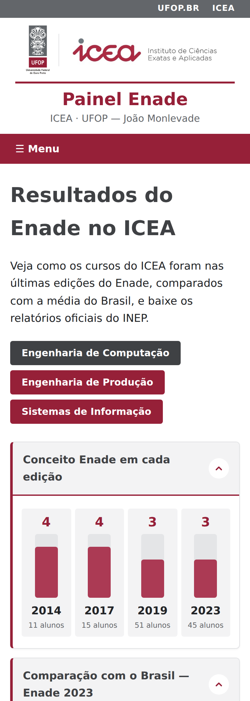</td>
  </tr>
</table>

## Destaques técnicos

- **Gráficos feitos à mão, sem biblioteca.** As barras, as colunas e a linha dos 60% são React e CSS
  puros, e o gráfico de evolução por disciplina é um SVG. A linha tracejada é um único elemento
  posicionado por variáveis CSS, que atravessa todas as barras e se adapta ao layout de computador e
  de celular.
- **Questões da prova na tela:** as imagens das questões (recortes dos cadernos de prova) são servidas
  pela API e abertas numa janela acessível (foco, Esc e clique fora para fechar).
- **Testes automatizados:** 168 testes no front (Vitest + Testing Library) e 247 na API. Cobrem os
  dados exibidos, a troca de curso, os links, os estados de erro e a integridade dos números copiados
  dos relatórios do INEP.
- **Integração contínua** no GitHub Actions (lint, testes, build e auditoria de segurança) e
  Dependabot com os pacotes do React agrupados, porque `react` e `react-dom` precisam ter a mesma
  versão.
- **Privacidade por padrão:** os nomes e e-mails dos alunos são trocados por um código com HMAC-SHA256
  antes de qualquer dado entrar no repositório. Os detalhes estão no repositório da API.
- **Configuração em um lugar só:** o endereço da API fica em `src/api.js` e muda com a variável
  `VITE_API_URL`, sem tocar no código.
- **Usabilidade:** link "pular para o conteúdo", seções expansíveis nativas (`<details>`, que
  funcionam pelo teclado) e botões com rótulos claros.
- **Informação sem exagero:** cada tela mostra poucos dados importantes, com explicações curtas das
  sigla (IES) para quem não conhece o vocabulário do Enade.

## Tecnologias

| Área | Ferramentas |
| --- | --- |
| Interface | React 19, React Router 7, CSS próprio (sem framework de UI) |
| Build | Vite 8 |
| Testes | Vitest 5, Testing Library, jsdom |
| Qualidade | Oxlint, Oxfmt, GitHub Actions, Dependabot |
| API | Node.js, Express (repositório separado) |

## Como funciona

```
Navegador ──HTTPS──▶ Nginx
                      ├─ arquivos ──▶ Site React     (este repositório)
                      └─ /api ──────▶ API Express    (Painel_Enade_UFOP_Back)
                                       └─▶ Arquivos de dados: notas do Moodle
                                           (anonimizadas), Enade e PDFs do INEP
```

## Como rodar

Pré-requisito: Node.js 22 ou mais novo, e a [API](https://github.com/LucasECota/Painel_Enade_UFOP_Back)
rodando em `http://localhost:3000` (`npm run dev` no repositório dela).

```bash
git clone https://github.com/LucasECota/Painel_Enade_UFOP_Front.git
cd Painel_Enade_UFOP_Front
npm install
npm run dev        # http://localhost:5173
```

| Comando | O que faz |
| --- | --- |
| `npm run dev` | Sobe o site em modo de desenvolvimento |
| `npm run build` | Gera a versão de produção em `dist/` |
| `npm test` | Roda os testes automatizados uma vez |
| `npm run test:watch` | Roda os testes e repete a cada alteração |
| `npm run lint` | Verifica o código com o Oxlint |

### Configuração

O endereço da API fica em `src/api.js`. Por padrão aponta para o backend local
(`http://localhost:3000/api`). Para outro endereço, defina `VITE_API_URL` antes do build (veja o
`.env.example`):

```bash
VITE_API_URL=https://api.exemplo.edu.br/api npm run build
```

Com o site e a API no mesmo domínio, use o endereço relativo `VITE_API_URL=/api`. No backend, libere
o endereço do site em `CORS_ORIGINS` quando forem domínios diferentes.

## Publicação

O site é publicado **somente com Docker**. Este repositório tem o `Dockerfile` do site (gera o build
do React e o serve com Nginx) e o `docker/nginx.conf` (repassa `/api/` para a API e devolve o
`index.html` nas rotas do site, para o F5 funcionar). O `docker-compose.yml`, que sobe site e API
juntos, e o guia completo para a TI ficam no repositório da API:
[DEPLOY.md](https://github.com/LucasECota/Painel_Enade_UFOP_Back/blob/main/DEPLOY.md).

## Testes

Usam [Vitest](https://vitest.dev) + Testing Library, ao lado do código (`*.test.jsx`). A API é
simulada em `src/test/api.js`, então os testes não precisam do backend no ar.

Cobrem o menu, as páginas com abas, os tópicos expansíveis e as páginas Início, Preparatório, Dados
Edições Anteriores (Análise das provas e Resultados): dados exibidos, troca de curso, ordenação e
comparação das tabelas, janela de ver questão, filtros dos rankings, links e erros da API.

O que os testes **não** cobrem é o visual (posição da linha dos 60%, cores, espaçamentos): o jsdom
não calcula layout. Isso é conferido abrindo a página no navegador. As imagens deste README foram
geradas assim, com o site rodando contra a API.

## Integração contínua (CI)

O arquivo `.github/workflows/ci.yml` faz o GitHub rodar, a cada push na `main` e em todo pull request:

1. **Lint, testes e build:** `npm ci`, `npm run lint`, `npm test` e `npm run build`;
2. **Auditoria:** `npm audit --audit-level=high` (falha se houver vulnerabilidade alta ou crítica,
   inclusive nas ferramentas de desenvolvimento).

O `.github/dependabot.yml` abre pull requests semanais quando uma dependência tem versão nova.

## Estrutura do projeto

```
src/
├── api.js                 endereço da API (VITE_API_URL)
├── App.jsx                rotas
├── components/
│   ├── DesempenhoPorArea.jsx  evolução por disciplina e rankings de acertos e erros
│   ├── GraficoEvolucao.jsx    gráfico de barras da evolução (SVG)
│   ├── Layout.jsx         cabeçalho, menu e rodapé
│   ├── ListaDeRelatorios.jsx  lista de relatórios do INEP para baixar
│   ├── PaginaComAbas.jsx  página com abas (a aba vai para o endereço, ?aba=)
│   ├── QuestaoModal.jsx   botão e janela "Ver questão" (imagem e gabarito)
│   ├── TabelaQuestoes.jsx tabelas de acertos por questão e de discursivas
│   └── Topico.jsx         seção que abre e fecha
├── gruposDeDisciplinas.js subgrupos de disciplinas do menu da evolução
├── desempenhoCache.js     guarda os dados do desempenho entre as abas
├── data/avaliaufop.js     cursos, módulos e links do Moodle
├── pages/                 Início, Preparatório Enade 2026 e Dados Edições Anteriores (cada uma com abas)
├── test/                  utilitários dos testes (API simulada)
└── index.css              estilos
docs/screenshots/          imagens deste README
```

## Fontes dos dados

- Relatórios de IES do Enade — **INEP** (UFOP, campus João Monlevade).
- Notas dos simulados — exports do Moodle da **UFOP Aberta**, anonimizados.

O INEP informa que as notas do Enade só são comparáveis dentro da mesma área e do mesmo ano, e não
entre edições. Por isso o painel mostra o resultado de cada edição separadamente e só compara o ICEA
com a média do Brasil no mesmo ano, sem calcular variações entre anos.

## Autoria

**Lucas Emanuel Cota Carneiro** · [github.com/LucasECota](https://github.com/LucasECota)
Orientação: prof. **Josemar Alves Caetano** · ICEA/UFOP · Programa Pró-Ativa
