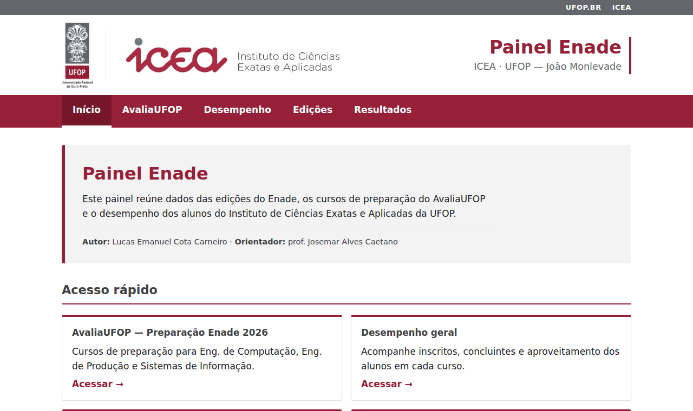
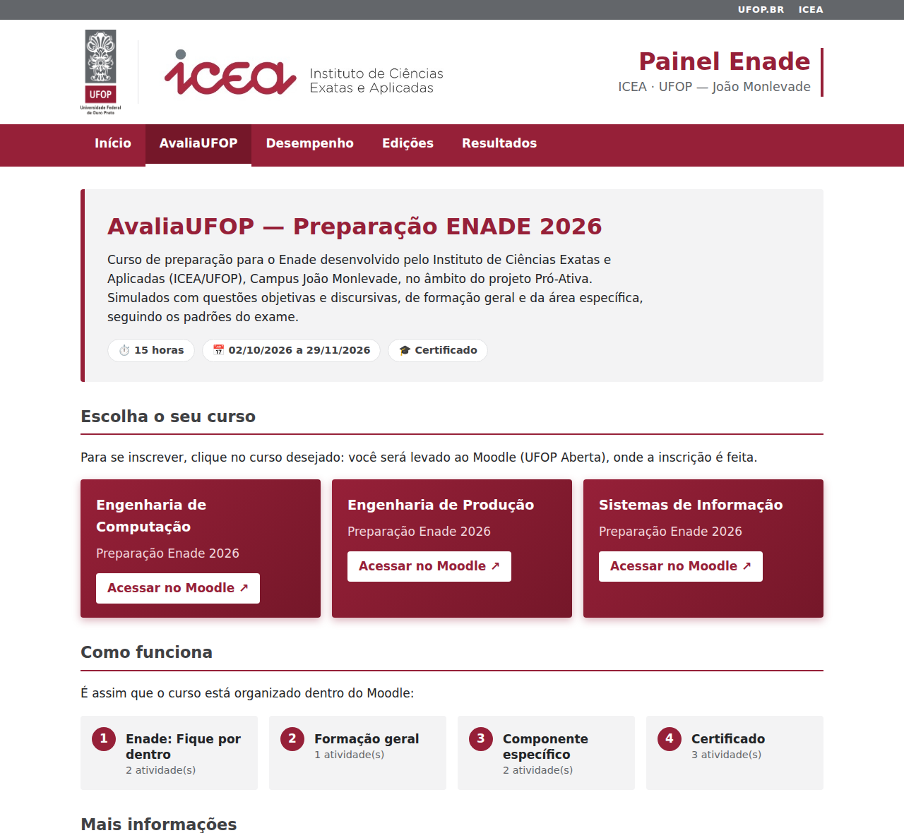
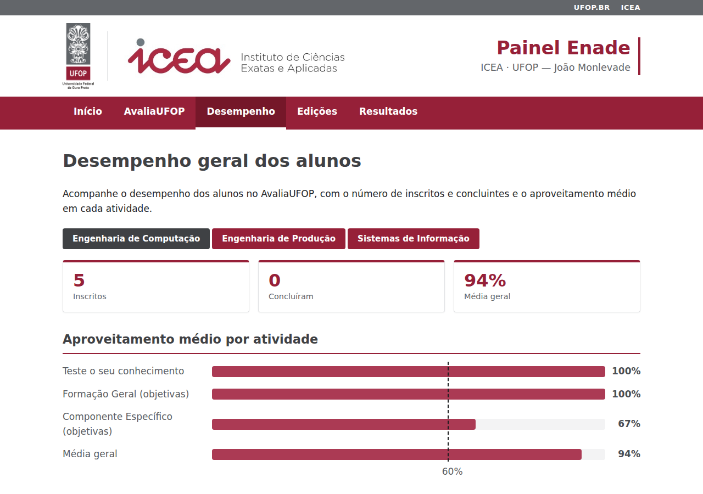
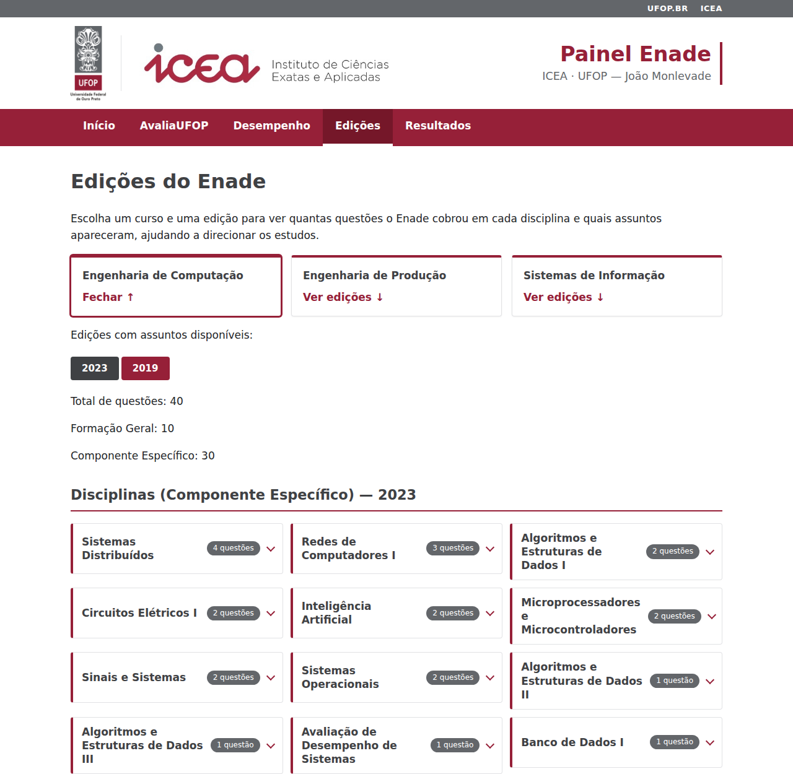
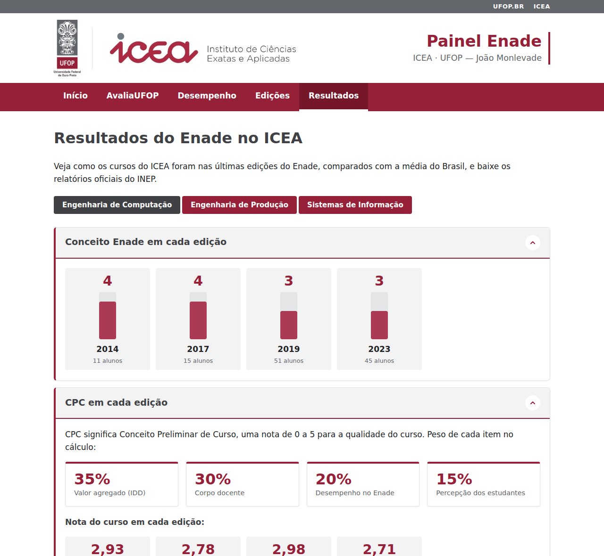
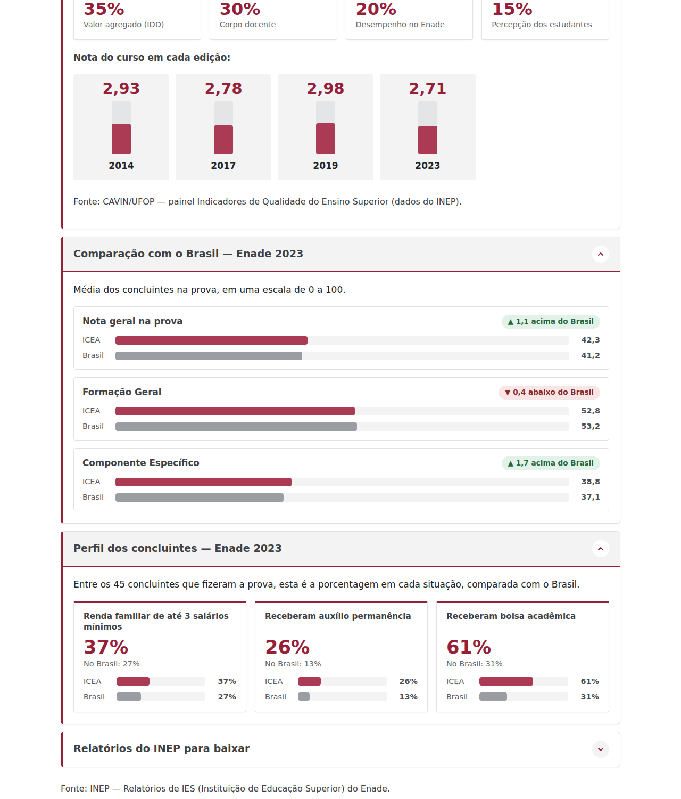
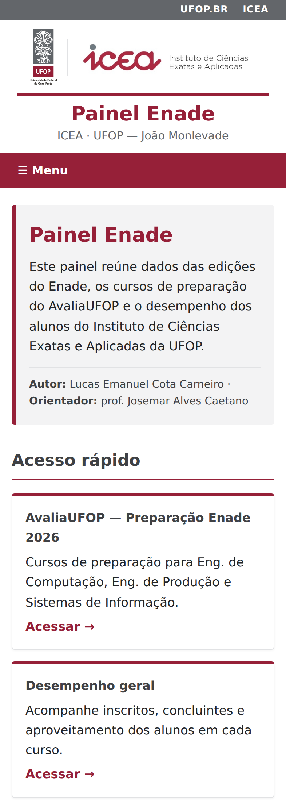
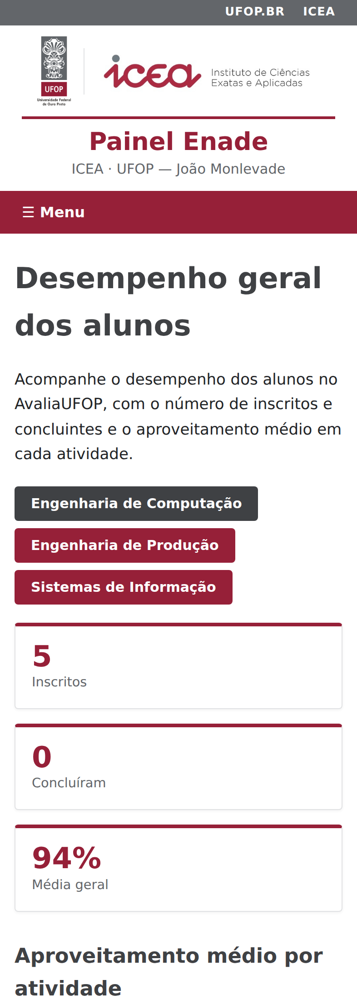
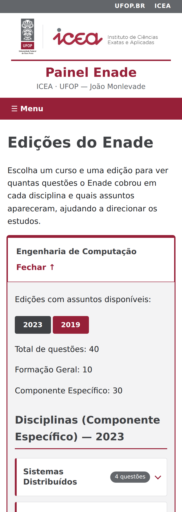
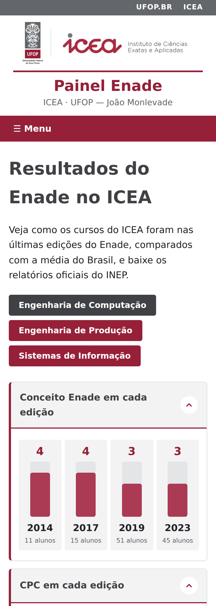

# Painel Enade — ICEA/UFOP

[](https://github.com/LucasECota/Painel_Enade_UFOP_Front/actions/workflows/ci.yml)


Painel web do **Instituto de Ciências Exatas e Aplicadas (ICEA) da UFOP**, em João Monlevade, que
reúne em um só lugar os dados do **Enade**: os cursos de preparação do projeto **AvaliaUFOP**, o que
cada edição cobrou, o desempenho dos alunos e os resultados oficiais do INEP, com comparação com a
média do Brasil e relatórios para baixar.

Projeto desenvolvido no âmbito do programa **Pró-Ativa (UFOP)**, por **Lucas Emanuel Cota Carneiro**,
com orientação do prof. **Josemar Alves Caetano**.

> **Repositório da API:** [Painel_Enade_UFOP_Back](https://github.com/LucasECota/Painel_Enade_UFOP_Back)
> (Node.js + Express). O guia para publicar os dois em um servidor está em
> [DEPLOY.md](https://github.com/LucasECota/Painel_Enade_UFOP_Back/blob/main/DEPLOY.md).

## O problema

Os estudantes de Engenharia de Computação, Engenharia de Produção e Sistemas de Informação fazem o
Enade, mas as informações sobre a prova ficam espalhadas: relatórios em PDF do INEP, páginas de
indicadores e cursos no Moodle. O painel junta tudo em uma navegação simples, para que o aluno
entenda **o que costuma cair na prova**, **como o curso se saiu** e **onde se preparar**.

## O que o painel mostra

### Início
Apresentação do painel e atalhos para as quatro áreas.



### AvaliaUFOP
Os três cursos de preparação para o Enade 2026 (um por curso), com a estrutura de módulos e
atividades e o botão que leva direto à inscrição no Moodle da UFOP.



### Desempenho
Inscritos, concluintes e aproveitamento médio dos alunos em cada atividade do AvaliaUFOP, com uma
linha tracejada marcando os 60% exigidos para o certificado. Os dados vêm de exports do Moodle,
**anonimizados** antes de chegarem ao repositório.



### Edições
O que o Enade cobrou em cada edição: quantas questões por disciplina e quais assuntos, para
direcionar os estudos. Cada disciplina abre e fecha para não sobrecarregar a leitura.



### Resultados
Conceito Enade e CPC de cada edição, comparação das médias do ICEA com as do Brasil (Formação Geral
e Componente Específico), perfil socioeconômico dos concluintes e os **relatórios oficiais do INEP
para baixar**. Os blocos são expansíveis.





### No celular
Todas as telas foram pensadas para telas pequenas, com menu recolhido e gráficos adaptados.

<table>
  <tr>
    <td></td>
    <td></td>
    <td></td>
    <td></td>
  </tr>
</table>

## Destaques técnicos

- **Gráficos feitos à mão, sem biblioteca.** As barras, as colunas e a linha dos 60% são React e CSS
  puros. A linha tracejada é um único elemento posicionado por variáveis CSS, que atravessa todas as
  barras e se adapta ao layout de computador e de celular.
- **Testes automatizados:** 61 testes no front (Vitest + Testing Library) e 88 na API. Cobrem os
  dados exibidos, a troca de curso, os links, os estados de erro e a integridade dos números copiados
  dos relatórios do INEP.
- **Integração contínua** no GitHub Actions (lint, testes, build e auditoria de segurança) e
  Dependabot com os pacotes do React agrupados, porque `react` e `react-dom` precisam ter a mesma
  versão.
- **Privacidade por padrão:** os nomes e e-mails dos alunos são trocados por um código com HMAC-SHA256
  antes de qualquer dado entrar no repositório. Os detalhes estão no repositório da API.
- **Configuração em um lugar só:** o endereço da API fica em `src/api.js` e muda com a variável
  `VITE_API_URL`, sem tocar no código.
- **Usabilidade:** link "pular para o conteúdo", seções expansíveis nativas (`<details>`, que
  funcionam pelo teclado) e botões com rótulos claros.
- **Informação sem exagero:** cada tela mostra poucos dados importantes, com explicações curtas das
  siglas (CPC, IES) para quem não conhece o vocabulário do Enade.

## Tecnologias

| Área | Ferramentas |
| --- | --- |
| Interface | React 19, React Router 7, CSS próprio (sem framework de UI) |
| Build | Vite 8 |
| Testes | Vitest 5, Testing Library, jsdom |
| Qualidade | Oxlint, Oxfmt, GitHub Actions, Dependabot |
| API | Node.js, Express (repositório separado) |

## Como funciona

```
Navegador ──HTTPS──▶ Nginx
                      ├─ arquivos ──▶ Site React     (este repositório)
                      └─ /api ──────▶ API Express    (Painel_Enade_UFOP_Back)
                                       └─▶ Arquivos de dados: notas do Moodle
                                           (anonimizadas), Enade e PDFs do INEP
```

## Como rodar

Pré-requisito: Node.js 22 ou mais novo, e a [API](https://github.com/LucasECota/Painel_Enade_UFOP_Back)
rodando em `http://localhost:3000` (`npm run dev` no repositório dela).

```bash
git clone https://github.com/LucasECota/Painel_Enade_UFOP_Front.git
cd Painel_Enade_UFOP_Front
npm install
npm run dev        # http://localhost:5173
```

| Comando | O que faz |
| --- | --- |
| `npm run dev` | Sobe o site em modo de desenvolvimento |
| `npm run build` | Gera a versão de produção em `dist/` |
| `npm test` | Roda os testes automatizados uma vez |
| `npm run test:watch` | Roda os testes e repete a cada alteração |
| `npm run lint` | Verifica o código com o Oxlint |

### Configuração

O endereço da API fica em `src/api.js`. Por padrão aponta para o backend local
(`http://localhost:3000/api`). Para outro endereço, defina `VITE_API_URL` antes do build (veja o
`.env.example`):

```bash
VITE_API_URL=https://api.exemplo.edu.br/api npm run build
```

Com o site e a API no mesmo domínio, use o endereço relativo `VITE_API_URL=/api`. No backend, libere
o endereço do site em `CORS_ORIGINS` quando forem domínios diferentes.

## Publicação

O guia de publicação (site e API juntos, em um servidor Linux com Nginx) está no repositório da API:
[DEPLOY.md](https://github.com/LucasECota/Painel_Enade_UFOP_Back/blob/main/DEPLOY.md). O
redirecionamento das rotas já está em `public/_redirects` (hospedagens estáticas); com Nginx, use o
`try_files` do exemplo do guia.

## Testes

Usam [Vitest](https://vitest.dev) + Testing Library, ao lado do código (`*.test.jsx`). A API é
simulada em `src/test/api.js`, então os testes não precisam do backend no ar.

Cobrem o menu, os tópicos expansíveis e as páginas Início, AvaliaUFOP, Edições, Desempenho e
Resultados (dados exibidos, troca de curso, links e erros da API).

O que os testes **não** cobrem é o visual (posição da linha dos 60%, cores, espaçamentos): o jsdom
não calcula layout. Isso é conferido abrindo a página no navegador. As imagens deste README foram
geradas assim, com o site rodando contra a API.

## Integração contínua (CI)

O arquivo `.github/workflows/ci.yml` faz o GitHub rodar, a cada push na `main` e em todo pull request:

1. **Lint, testes e build:** `npm ci`, `npm run lint`, `npm test` e `npm run build`;
2. **Auditoria:** `npm audit --audit-level=high` (falha se houver vulnerabilidade alta ou crítica,
   inclusive nas ferramentas de desenvolvimento).

O `.github/dependabot.yml` abre pull requests semanais quando uma dependência tem versão nova.

## Estrutura do projeto

```
src/
├── api.js                 endereço da API (VITE_API_URL)
├── App.jsx                rotas
├── components/
│   ├── Layout.jsx         cabeçalho, menu e rodapé
│   ├── Topico.jsx         seção que abre e fecha
│   └── BlocoCpc.jsx       bloco do CPC (fácil de remover)
├── data/avaliaufop.js     cursos, módulos e links do Moodle
├── pages/                 Início, AvaliaUFOP, Desempenho, Edições e Resultados
├── test/                  utilitários dos testes (API simulada)
└── index.css              estilos
docs/screenshots/          imagens deste README
```

## Fontes dos dados

- Relatórios de IES do Enade — **INEP** (UFOP, campus João Monlevade).
- Indicadores de qualidade (CPC) — painel da **CAVIN/UFOP**, com dados do INEP.
- Notas dos simulados — exports do Moodle da **UFOP Aberta**, anonimizados.

O INEP informa que as notas do Enade só são comparáveis dentro da mesma área e do mesmo ano, e não
entre edições. O painel respeita essa regra na forma como apresenta os números.

## Autoria

**Lucas Emanuel Cota Carneiro** · [github.com/LucasECota](https://github.com/LucasECota)
Orientação: prof. **Josemar Alves Caetano** · ICEA/UFOP · Programa Pró-Ativa
